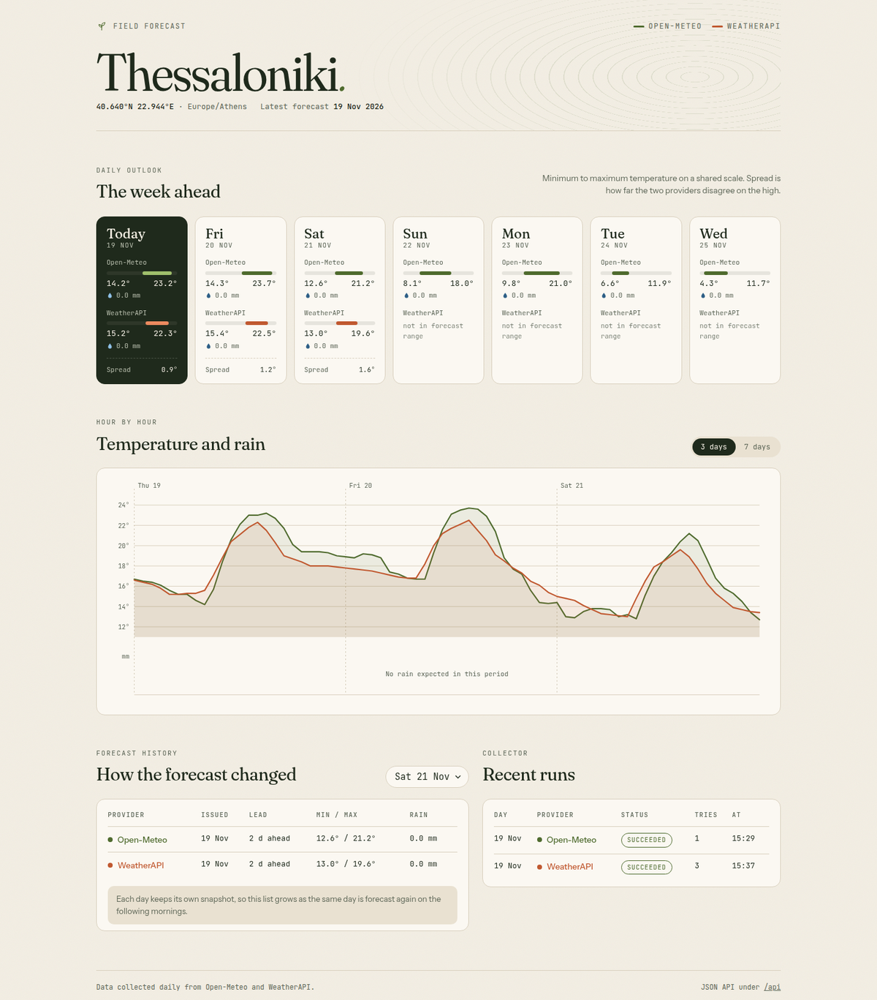

# Weather Forecast Collector

Once a day the app fetches the forecast for a location from Open-Meteo and WeatherAPI and
stores hourly and daily temperature and precipitation in PostgreSQL. The data can be read
back through a small JSON API.

I keep every day's forecast instead of overwriting it, so you can see both the latest
forecast and how a provider's forecast for a given day changed over time.

## 1. Installation and setup

You need Docker (with Compose v2) and a free WeatherAPI key from
https://www.weatherapi.com/signup.aspx. Open-Meteo doesn't need a key.

```bash
cp .env.example .env
# put your key in WEATHERAPI_KEY
docker compose up -d --build
```

This starts Postgres, runs the migrations and seeds one location (Thessaloniki), then
starts the app (PHP-FPM behind nginx) and a scheduler container. Open
http://localhost:8080 for a small dashboard, the API is under `/api` (change the port with
`APP_PORT`).

The scheduler collects every morning. To collect right away:

```bash
docker compose exec app php artisan forecasts:collect
```

You can limit it with `--provider=open_meteo` or `--location=1`, and `--force` fetches
again even if today is already stored. It returns a non-zero exit code if a provider failed.

Tests use a separate `weather_test` database and fake HTTP responses:

```bash
docker compose --profile test run --rm --build tests
```

Environment variables:

- `WEATHERAPI_KEY`: required for WeatherAPI
- `WEATHER_PROVIDERS`: which providers to collect, default `open_meteo,weatherapi`
- `OPEN_METEO_FORECAST_DAYS` (default 7, max 16) and `WEATHERAPI_FORECAST_DAYS` (default 3, the free plan limit)
- `WEATHER_SCHEDULE_START`, `WEATHER_SCHEDULE_END`, `WEATHER_SCHEDULE_TIMEZONE`: the collection window, default 06:00 to 12:00 Europe/Athens
- `WEATHER_LOCATION_NAME`, `_LATITUDE`, `_LONGITUDE`, `_TIMEZONE`: the seeded location
- `WEATHER_HTTP_TIMEOUT`: request timeout in seconds, default 15
- `DB_*`: database connection, also used to create the Postgres container
- `OPEN_METEO_BASE_URL`, `WEATHERAPI_BASE_URL`: optional, only if you need to point to another host

### Dashboard

http://localhost:8080 shows the collected data: both providers side by side for each day
(with how much they disagree), an hourly temperature and rain chart, how the forecast for a
day changed between collections, and the latest runs.



### Endpoints

- `GET /api/locations`
- `GET /api/locations/{id}/forecasts/daily`
- `GET /api/locations/{id}/forecasts/hourly`
- `GET /api/locations/{id}/forecasts/daily/{date}/revisions`: every forecast each provider gave for that date
- `GET /api/forecast-runs`: log of collections, filter with `location_id`, `provider`, `status`

`daily` and `hourly` return the latest forecast of each provider. Optional filters:
`provider`, `issued_on` (forecast collected on a specific day) and `from`/`to` (days in the
location's timezone). Hourly times are returned in UTC.

```bash
curl "localhost:8080/api/locations/1/forecasts/daily?from=2026-11-20&to=2026-11-22"
curl "localhost:8080/api/locations/1/forecasts/hourly?provider=open_meteo&from=2026-11-20&to=2026-11-20"
curl "localhost:8080/api/locations/1/forecasts/daily/2026-11-22/revisions"
curl "localhost:8080/api/forecast-runs?status=failed"
```

## 2. Implementation choices

I used Laravel 13 on PHP 8.4 with PostgreSQL 17. Laravel already has what I needed (scheduler,
HTTP client with retries, migrations, validation, cache locks), so I didn't add any other
packages.

Tables:

- `locations`
- `forecast_runs`: one row per location, provider and issue date (the local date the
  forecast was collected). It also keeps the status, attempts and last error.
- `hourly_forecasts`: time in UTC, temperature (°C), precipitation (mm)
- `daily_forecasts`: local date, min/max/mean temperature, total precipitation

Each provider class converts its response to the same format before saving. Open-Meteo is
asked for unix timestamps and WeatherAPI returns `time_epoch`, so hourly values are stored
in UTC without DST issues. Daily values use the location's local date, same as both APIs.
If a response is missing fields or has non-numeric values the whole run fails and nothing
is saved. A `null` from the API is stored as `null`.

The dashboard at `/` is a single Blade view with plain JavaScript and SVG charts. It only
reads the JSON API, so there's no frontend build step. It shows the two providers side by
side, the hourly chart, how the forecast for a day changed, and the latest runs.

Adding a provider means writing a class that implements `ForecastProvider` and adding it to
`config/weather.php`. Adding a location is a new row in `locations`.

Error handling:

- Providers are collected separately, so if one fails the other is still stored.
- Requests have a timeout and are retried twice, only on connection errors, 5xx and 429.
  An invalid key or exceeded quota fails immediately.
- The values of a run are saved in one transaction, and a failed refetch doesn't remove
  data that was already stored.
- Errors are logged and saved on the run. If a `--force` refetch fails it's only logged, so
  the data already stored for the day stays as it was. The API key is removed from error
  messages.
- A problem with one location (for example a wrong timezone) fails only that location.
- A lock per location/provider stops two collections of the same thing running together.

The command runs every hour between 06:00 and 12:00 but skips providers that already have
today's forecast, so normally there's one request per provider per day and a failed
morning run gets retried an hour later. That's far below the free limits (Open-Meteo
10,000 calls/day, WeatherAPI 100,000 calls/month).

Some trade-offs:

- Each variable is a column. That keeps queries simple, but a new variable needs a
  migration. If the number of variables grows a lot I'd switch to a long table.
- Running again on the same day with `--force` replaces that day's data, so there's one
  snapshot per day.
- Daily mean temperature comes from each provider as-is, I don't calculate it from the
  hourly values.

## 3. Incomplete requirements

Everything in the brief is done. I left out:

- Managing locations through the API or a command. The first one comes from `.env` and
  others can be added to the table directly.
- Authentication on the API.

## 4. Next steps

- Store observed weather so each provider's accuracy can be measured.
- A queued job per location and provider when there are many locations.
- Partition `hourly_forecasts` once it gets big.
- An endpoint comparing providers side by side.
- Alert when a provider fails for the whole morning.
- Location management and an OpenAPI spec.

## 5. Additional notes

- The issue date uses the location's timezone, so a run just after midnight counts for the
  new day.
- On a normal server the scheduler container can be replaced by one cron entry running
  `php artisan schedule:run` every minute.
- Each provider snaps the coordinates to its own nearest point (for the default location
  WeatherAPI returns Agios Pavlos at 40.641, 22.96 and Open-Meteo a grid point at
  40.666, 22.89), which explains part of the difference between them.
- Open-Meteo's free API is for non-commercial use, so production would need a paid plan.
  The base URL is configurable with `OPEN_METEO_BASE_URL`.
